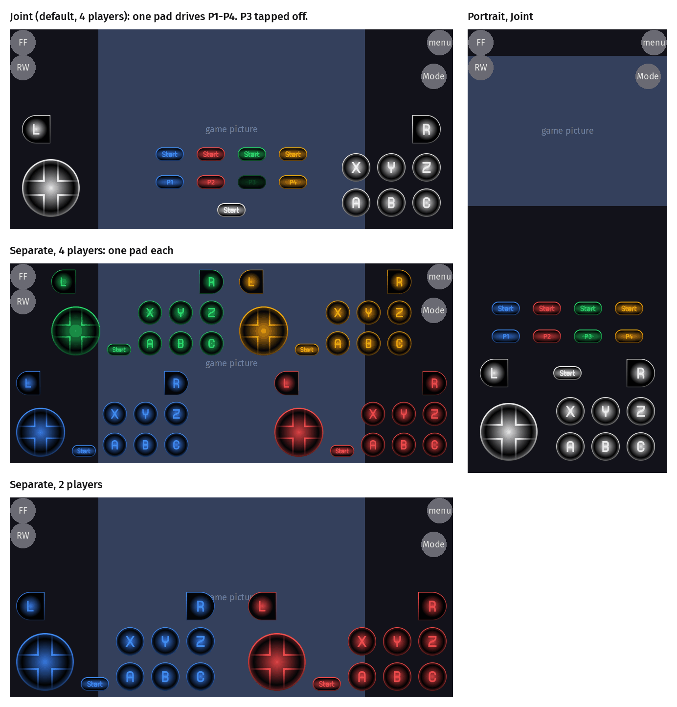

# Emu-SoloSquad

Emu-SoloSquad is a set of Android emulator forks of [Rakashazi's emu-ex-plus-alpha](https://github.com/Rakashazi/emu-ex-plus-alpha) (commit `1c12fac`). One person can drive several players from a single touchscreen.

The latest published build is [Saturn Quad v1.2](https://github.com/sevesghost/Emu-SoloSquad/releases/latest).

| App | System | Players on one screen | App id | Launcher name |
|---|---|---|---|---|
| NEO-Duo | Neo Geo | 2 (Joint or Separate), or the original one-player layout | `com.sevesghost.neoduo` | NEO-Duo |
| Saturn Quad 4P | Sega Saturn | 1, 2, or 4 (one joint pad for all, or one pad each) | `com.sevesghost.saturnquad` | Saturn Quad |

BIOS images and game ROMs are not included. You supply your own legally obtained files.

## NEO-Duo

NEO-Duo is a Neo Geo emulator for Android. It installs next to the original NEO.emu package.

### What you can do

On a fresh install the on-screen controls start in **two-player** mode, using the **Joint** layout:

- One set of buttons (D-pad, A–D, turbo A–D, A+B, C+D, A+B+C, and the turbo combos) sends each press to **both** players. In landscape the D-pad stays on the left and the face buttons sit in two rows on the right.
- Small per-player Coin and Start buttons sit in the top corners. Joint mode also has a white shared Select and Start at the top center.
- **Separate** mode puts a blue Player 1 set on the left and a mirrored red Player 2 set on the right. An optional row of white buttons at the bottom center can drive both players at once (off by default) and stays at least 12 mm clear of the player buttons.
- A Mode button at the top of the screen switches Joint and Separate when it is held for half a second. While two-player mode is on, the old single-player Virtual Gamepad Player option is greyed out.
- Turning **One Person, Both Players** off restores the original single-player touch layout. Turning it back on brings the Mode button back.
- A removed Mode button stays removed across relaunch, and a moved or hidden Mode button keeps that position and hidden state, while two-player mode stays on. There is no extra config key: the removal is bit 7 of the on-screen UI-button trailer. **Reset UI Groups** clears the removal and puts a shown Mode button back at the default position.
- Each set has its own size and opacity, including the shared buttons. Player 1 and Player 2 start at 50% opacity and the shared row at 40%. Lock P1/P2 Size keeps the two face sizes equal. Changing a size leaves dragged positions where they are. Buttons never shrink below 9 mm; a tight screen packs the gaps instead. **Reset Emulator Button Positions** puts the current mode back on its default anchors.
- Layouts are stored in millimetres from the screen edges under config key `CFGKEY_VCONTROLLER_DEVICE_BUTTONS_V3` (`configId` 0 = separate, 1 = joint), with a separate landscape and portrait arrangement. The turbo row stays inside the bottom 40% of the screen. Wider than 16:10 keeps the controls over the picture. 16:10 or narrower shrinks the game image and leaves a strip along the bottom.
- The game picture can be dragged anywhere on the screen from **Set Video Position**, with Smaller/Larger controls and a reset, or positioned from Video settings (horizontal offset, vertical offset, and placement scale). Landscape and portrait remember their own offsets and scale. The touch pads stay drawn above the picture.
- Launching the app mixes with other audio (YouTube, music) instead of taking exclusive audio focus. That default is not switched back on later.
- Leaving the touch setup with Back writes the config immediately. Pausing or exiting the app writes it again.

### Save states

The 68000 core is now [Musashi 4.x](https://github.com/kstenerud/Musashi) (MIT) on every ABI, including 32-bit ARM. The Z80 core is [MAME's current Z80](https://github.com/mamedev/mame/tree/master/src/devices/cpu/z80) (BSD-3-Clause), also on every ABI. The old non-commercial Musashi 3.32, Portable Z80 3.9, and GPL-2-only Cyclone cores are gone.

Because of that, **save states written by the previous cores do not load**. The state header uses new core flags (`m68k` 0x6, `z80` 0x9) and rejects older files.

## Saturn Quad 4P

Saturn Quad is the Saturn.emu shell built so one person can drive up to four Saturn players from one touchscreen. The launcher name is **Saturn Quad** and the app id is `com.sevesghost.saturnquad`, so it installs next to the original Saturn.emu package. Saves and states in Saturn.emu do not move across by themselves. [v1.2 release notes](https://github.com/sevesghost/Emu-SoloSquad/releases/tag/v1.2) describe how to point both apps at the same save folder.

On-screen Input Setup has **On-screen Players** (**1 Player**, **2 Players**, **4 Players**; a fresh install starts at 4) and **Control Layout** (**Joint** or **Separate**; a fresh install starts at Joint). Holding the Mode button for half a second also switches the layout, and a short message names the new one.



*Default layouts on a 151 x 68 mm phone, drawn from `QuadLayout.hh` with the app's own button art. Top left: Joint with P3 unlinked.*

**Joint: one pad drives every player**

- One white D-pad, A B C / X Y Z, L, R and Start. Each press goes to every linked player at once, so all four characters move and act together.
- The **P1 P2 P3 P4** chips (blue, red, green, amber) sit at the bottom centre. Tap a chip to link or unlink that player; an unlinked chip turns dark. Hold a chip for half a second to drive only that player, and hold it again to link everyone. One player always stays linked. Use this on character-select screens, or to walk one character on its own.
- Each player's own coloured **Start** sits above the chips (to join a game or pause as that player). The white Start under the chips presses Start for every linked player.
- Changing a link while a button is held lets go of it for a player that leaves and presses it for a player that joins, so nothing sticks.
- Links are not saved: every launch starts with all players linked.

**Separate: one pad per player**

- P1 blue, P2 red, P3 green, P4 amber. A press on one pad goes only to that player. Two players share the bottom edge; four players use the four corners of the screen.
- The default positions keep every pad off the corner buttons (fast-forward and rewind on the left, Open Menu and Mode on the right) and keep L, R and Start off the D-pad and face buttons. On a phone the four pads use about 8.5 mm buttons so they fit.

**1 Player** uses the joint pad as a normal single pad, for the port chosen in **Virtual Gamepad Player** (saved in the config). Ports 3-6 turn on a Port 1 multitap; ports 7-12 also turn on a Port 2 multitap, so those ports exist on the Saturn bus.

More details:

- Joint and Separate keep their own buttons, positions and hidden states. Switching the layout or the player count shows the other set; it does not rebuild or move anything. **Reset Emulator Button Groups** rebuilds both.
- The setup screens, Set Button Positions included, only show and move the buttons of the current player count and layout.
- **Joint Pad Button Size** and **Joint Pad Opacity** set the joint pad. **Player Pad Button Size** sets all four separate pads, and **Player Color Opacity** sets everything drawn in a player's colour, chips included.
- A group added with **Add New Button Group** shows in every layout and presses for every linked player.
- Four on-screen players put a multitap with gamepads on controller port 1, laid over the game's own input settings instead of written into them. While a game is running, an overlay tap that is already on stays so player 2 is not remapped when you switch to 1 or 2 players. Switching from 1 or 2 players to 4 also leaves the current hookup in place, and a message asks you to reset or reload the game for players 3 and 4. In 1 Player mode, changing Virtual Gamepad Player to port 3 or higher turns on the needed taps immediately. Loading a game applies only the taps the current layout and Virtual Gamepad Player need, plus any you turned on yourself (including a light gun). Console Options greys out the overlay taps and their pads while they are in use.
- The Mode button's removal, position and hidden state are kept as before (bit 7 on the UI-button trailer, no new config key; **Reset UI Groups** brings it back). A new or reset Mode button sits under Open Menu at the top right.
- Joint buttons are stored in the existing `CFGKEY_VCONTROLLER_DEVICE_BUTTONS_V3` block with duo roles 128-143. A v1.2 config loads as it was and gains the joint pad; its own pads stay where they were saved.
- Back out of On-screen Input Setup (or out of Set Button Positions) writes the config before the screen closes. Pausing or exiting the app writes it again.
- v1.2 is signed with the Android debug key. If you installed an earlier test build, uninstall it first: it was signed with a different certificate, and uninstalling clears that install's saved settings.

Host tests for the on-screen controls (no Android tools needed):

```bash
for t in quadControlsTest quadLayoutTest duoModeButtonTest; do
	g++ -std=c++20 -Wall -Wextra -Werror -I EmuFramework/include EmuFramework/tests/$t.cc -o /tmp/$t && /tmp/$t
done
```

`quadLayoutTest` checks the default Joint and Separate layouts on phone and tablet sizes, landscape and portrait: every button stays on screen, out of the UI corners, and clear of every other button's touch area.

## Credits and licenses

Emu-SoloSquad as a whole is **GPL-3.0-or-later**, the same license as Imagine, EmuFramework, NEO.emu, and Saturn.emu. See `COPYING.GPL`.

Upstream:

- Imagine and EmuFramework, and the NEO.emu and Saturn.emu application shells — © Robert Broglia, GPL-3.0-or-later. <https://github.com/Rakashazi/emu-ex-plus-alpha>
- Gngeo — © the Gngeo team, GPL-2.0-or-later. The Neo Geo machine code under `NEO.emu/src/gngeo` comes from that project. The ARM and x86 blitters (`video_arm.s`, `video_i386.asm`) are not in this tree; every ABI uses the C blitter.
- 68000 — Musashi © Karl Stenerud, MIT. Sources are in `NEO.emu/src/musashi`. The 68000 has no FPU or PMMU, so `m68kfpu.c`, `m68kmmu.h`, and SoftFloat are not included.
- Z80 — MAME's ZiLOG Z80 core, BSD-3-Clause, © Juergen Buchmueller and the MAME team. Sources and the generated `z80.hxx` are in `NEO.emu/src/z80`. Regenerate the execution loop with `python3 z80make.py z80.lst z80.hxx` from that directory if you update `z80.lst`.
- YM2610 (`ym2610.c`) is GPL-2.0-or-later, © Jarek Burczynski and Tatsuyuki Satoh, from MAME's `fm.cpp` and `ymdeltat.cpp`. The interface in `2610intf.c` is BSD-3-Clause © Ernesto Corvi plus the Gngeo GPL-2.0-or-later integration. Neo Geo protection (`neocrypt.c`) stays under MAME's BSD-3-Clause terms. None of these were rewritten onto ymfm.
- The calendar chip in `pd4990a.c` is an original implementation. Its shift register and strobe follow MAME's BSD-3-Clause `upd1990a` device (© Curt Coder, hap, and the MAME team). The old non-commercial MAME `pd4990a` sources are not in this tree.
- Mednafen — © the Mednafen Team, GPL-2.0-or-later. Saturn.emu's machine code is under `Saturn.emu/src/ss`. The shared library `mednafen_common` is built from `EmuFramework/src/shared` (Mednafen sources plus the `mednafen-emuex` glue) and Saturn.emu links it.
- LZMA — Igor Pavlov's LZMA SDK, public domain, under `EmuFramework/src/shared/lzma`. CHD images go through this decoder.
- libchdr — MAME Compressed Hunks of Data, BSD-3-Clause, © Aaron Giles, under `EmuFramework/src/shared/libchdr`.
- The image shaders in `EmuFramework/res/shaders` (direct, scale, and the edge-directed smoother, including the fallback variants) are original GPL-3.0-or-later code. The previous unlicensed hq2x and Scale2x shader text was replaced.
- The 4-clause BSD `memcpy.S` and the unused zlib `crypt.h` are not in this tree. BTstack (non-commercial) is not built or shipped; Android uses the platform Bluetooth adapter.
- Other bundled libraries are listed in `THIRD-PARTY-NOTICES`.

No BIOS, ROMs, keystores, or signing passwords are in this repository.

## Building a signed Android APK

Host tools used for the release build: JDK 21, Android SDK platform 36, Android NDK r29, and the NDK's Clang (21+). CMake is fetched by the project scripts.

```bash
export ANDROID_SDK_ROOT="$HOME/android-sdk"   # must contain platforms/android-36 and an NDK
export ANDROID_HOME="$ANDROID_SDK_ROOT"
export IMAGINE_PATH="$PWD/imagine"
export EMUFRAMEWORK_PATH="$PWD/EmuFramework"
export IMAGINE_SDK_PATH="${IMAGINE_SDK_PATH:-$HOME/imagine-sdk}"

# Imagine's third-party libraries (all ABIs the meta build lists: armv7, arm64, x86, x86_64)
( cd imagine/bundle/all && ./makeAll-android.sh install )

# Point the makefiles at this tree
./imagine/android.sh config
./imagine/android.sh installLinks --config Release
./EmuFramework/android.sh config
./EmuFramework/android.sh installLinks --config Release

# Release signing. Keep the keystore and passwords outside the repo.
# ~/.gradle/gradle.properties (mode 600) — do not commit this file:
#   ANDROID_KEY_STORE=/path/to/release.keystore
#   ANDROID_KEY_STORE_PASSWORD=...
#   ANDROID_KEY_ALIAS=...
#   ANDROID_KEY_PASSWORD=...
# Without those properties the release build is signed with the debug key.

cd NEO.emu
make -f android.mk android-apk CONFIG=Release

cd ../Saturn.emu
make -f android.mk android-apk CONFIG=Release
```

NEO-Duo's universal APK is `NEO.emu/build/android/build/outputs/apk/release/NeoDuo-release.apk` (`arm64-v8a`, `armeabi-v7a`, `x86_64`, and `x86`). Saturn Quad's APK is `Saturn.emu/build/android/build/outputs/apk/release/SaturnEmu-release.apk`. `Saturn.emu/config.mk` sets `android_arch` to `arm64` and `x86_64`. BIOS and game archives are not packaged. The file published as v1.2 is `Saturn-Quad-v1.2.apk`.

## ภาษาไทย

Emu-SoloSquad เป็นชุดแอป Android ที่แยกมาจาก emu-ex-plus-alpha ของ Rakashazi ให้คนคนเดียวควบคุมผู้เล่นหลายคนจากจอสัมผัสจอเดียว

| แอป | เครื่อง | ผู้เล่นบนจอเดียว | รหัสแอป | ชื่อบนหน้าจอ |
|---|---|---|---|---|
| NEO-Duo | Neo Geo | 2 คน (Joint หรือ Separate) หรือเลย์เอาต์ผู้เล่นคนเดียวแบบเดิม | `com.sevesghost.neoduo` | NEO-Duo |
| Saturn Quad 4P | Sega Saturn | 1, 2 หรือ 4 คน (จอยรวมชุดเดียว หรือแยกคนละชุด) | `com.sevesghost.saturnquad` | Saturn Quad |

รุ่นที่เผยแพร่ล่าสุดคือ [Saturn Quad v1.2](https://github.com/sevesghost/Emu-SoloSquad/releases/latest)

NEO-Duo ติดตั้งคู่กับ NEO.emu เดิมได้ ติดตั้งใหม่จะเริ่มที่โหมดสองผู้เล่นแบบ Joint ปุ่ม Mode กดค้างครึ่งวินาทีสลับ Joint กับ Separate ถ้าลบ ย้าย หรือซ่อนปุ่ม Mode ไว้ ค่านั้นอยู่หลังเปิดแอปใหม่เมื่อยังเปิดโหมดสองผู้เล่น Reset UI Groups นำปุ่ม Mode กลับมา คอร์ 68000 และ Z80 เปลี่ยนแล้ว เซฟสเตทรุ่นเก่าเปิดไม่ได้ ไม่มี BIOS หรือรอมในแอป

Saturn Quad ทำมาให้คนคนเดียวคุมผู้เล่น Saturn ได้ถึง 4 คนจากจอสัมผัสจอเดียว ติดตั้งคู่กับ Saturn.emu เดิมได้ เซฟไม่ย้ายตามเอง เลือกจำนวนผู้เล่นที่ On-screen Players เป็น 1, 2 หรือ 4 และเลือก Control Layout เป็น Joint หรือ Separate (ติดตั้งใหม่เริ่มที่ 4 คนแบบ Joint) กดปุ่ม Mode ค้างครึ่งวินาทีก็สลับเลย์เอาต์ได้ และมีข้อความบอกว่าเปลี่ยนเป็นแบบไหน

Joint: จอยชุดเดียวสีขาว (D-pad, A B C / X Y Z, L, R, Start) กดทีเดียวไปถึงผู้เล่นทุกคนที่ลิงก์อยู่ ตัวละครทั้ง 4 ตัวขยับพร้อมกัน ปุ่มเล็ก P1 P2 P3 P4 (น้ำเงิน แดง เขียว ส้ม) อยู่กลางจอด้านล่าง แตะ = เปิด/ปิดการคุมคนนั้น (ปิดแล้วปุ่มจะมืด) กดค้างครึ่งวินาที = คุมคนนั้นคนเดียว กดค้างอีกครั้ง = กลับมาคุมทุกคน ต้องมีอย่างน้อยหนึ่งคนเสมอ ใช้ตอนหน้าเลือกตัวละครหรืออยากเดินตัวเดียว ปุ่ม Start สีของแต่ละคนอยู่เหนือปุ่ม P (ไว้กดเข้าร่วมเกม) ส่วน Start สีขาวด้านล่างกด Start ให้ทุกคนที่ลิงก์อยู่ เปลี่ยนลิงก์ตอนกดปุ่มค้างอยู่ ปุ่มจะไม่ค้าง การลิงก์ไม่ถูกเซฟ เปิดแอปใหม่ทุกคนถูกลิงก์

Separate: จอยแยกคนละชุดตามสี 2 คนอยู่ขอบล่างซ้าย/ขวา 4 คนอยู่สี่มุมจอ ตำแหน่งเริ่มต้นไม่ทับปุ่มมุมจอ (FF/Rewind ซ้าย, Menu/Mode ขวา) และ L R Start ไม่ทับ D-pad หรือปุ่มหน้า บนมือถือ 4 คนปุ่มจะเล็กลงเหลือราว 8.5 มม. 1 Player ใช้จอยชุด Joint เป็นจอยธรรมดาของผู้เล่นที่เลือกใน Virtual Gamepad Player

Joint กับ Separate เก็บตำแหน่งและการซ่อนปุ่มแยกกัน สลับแล้วไม่หาย หน้าตั้งปุ่มแสดงและลากได้เฉพาะปุ่มของโหมดที่ใช้อยู่ 4 คนจะเปิด multitap พอร์ต 1 พร้อมจอย 4 ตัวทับค่าของเกมไว้ชั่วคราว ไม่เขียนลงค่าของเกม กลับไป 1 หรือ 2 คนค่าเดิม (รวมปืนหรือ multitap ที่เปิดเอง) จะกลับมา คอนฟิกจาก v1.2 เปิดได้เหมือนเดิมและได้จอย Joint เพิ่ม ปุ่ม Mode ที่ลบไปยังไม่กลับมาเอง Reset UI Groups ทำให้กลับมา ปุ่ม Mode ใหม่อยู่ใต้ปุ่ม Menu มุมขวาบน v1.2 เซ็นด้วย debug key ถ้าเคยลงรุ่นทดสอบเก่าให้ถอนก่อนเพราะใบรับรองคนละตัว

ทั้งโปรเจกต์เป็น GPL-3.0-or-later แกน Saturn มาจาก Mednafen (GPL-2.0-or-later) CHD ใช้ libchdr (BSD-3-Clause) และ LZMA (public domain) ไม่มี BIOS, รอม, keystore หรือรหัสผ่านอยู่ในที่เก็บนี้
